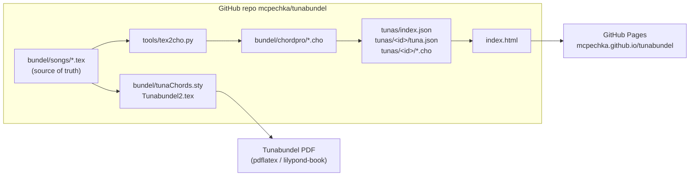

# Cancionero Común — system overview and roadmap

Background documentation for the Tunabundel website and the ChordPro songbook built from it. Read this before changing the converter, the site or the song files.

Status: October 2026. The site works and shows all 52 songs of the current bundel. Chords, melodies and tuna information still need work (see [Roadmap](#roadmap)).

---

## 1. What this is

Tuna Ciudad de Luz has kept its songbook (*bundel*) in LaTeX since 2015 (`bundel/`, custom package `tunaChords.sty`, see `documentation/HOWTO.MD` and `Feature list.txt`). The PDF is good to print, but the songs could only be read in the PDF and only edited by someone with a LaTeX setup.

The Cancionero Común adds three things on top of the bundel, without replacing it:

1. **ChordPro copies** of every song (`bundel/chordpro/*.cho`), generated from the `.tex` files. ChordPro is the plain-text standard most songbook apps and tools read.
2. **A website** (`index.html`, GitHub Pages) that shows the songs with transposing, DO-RE-MI / C-D-E notation and side-by-side comparison of versions.
3. **A `tunas/` folder** so other tunas can add their own versions of the same songs. Tunas play the same repertoire with small differences in chords and structure; the site groups songs by title and highlights those differences.

## 2. System overview



- **Source of truth for Tuna Ciudad de Luz is still the `.tex` files.** The `.cho` files are generated; edit the `.tex` and regenerate (section 5). If the tuna decides to drop LaTeX later, the `.cho` files can become the source and `tools/tex2cho.py` can be retired.
- **The website is static.** It has no server and no database. On page load it reads `tunas/index.json`, then each tuna's `tuna.json`, then every song file listed there, and builds the songbook in the browser. Changing the repo changes the site on the next GitHub Pages build (about a minute).
- **Contributions go through pull requests.** Nobody edits on the website itself.

### 2.1 Second copy on claude.ai (not synced)

There is also an editable version of the songbook published as a Claude artifact. It stores songs in its own database, lets invited people add versions and recordings in the browser, and can import `.tex` and PDF songbooks. It does **not** sync with this repo. Treat the GitHub site as the main one; the artifact is useful for quick experiments and has an "Exportar copia" button that downloads everything as JSON.

## 3. Repository layout (relevant parts)

| Path | What it is |
|---|---|
| `bundel/songs/*.tex` | One LaTeX file per song (74 files, 5 of them empty templates) |
| `bundel/Tunabundel2.tex` | Main bundel; its `\input{songs/...}` lines decide which songs are in the current edition (52) |
| `bundel/tunaChords.sty` | The LaTeX package: `song`, `verse`, `instrumental`, `sidenote`, `translation` environments, `\chord`, `\measure`, `\repetition`, `\rhythmandkey` |
| `bundel/chordpro/*.cho` | Generated ChordPro, one per song (69) |
| `bundel/theory/` | Chord charts, rhythms (*slagjes*), Spanish/Portuguese pronunciation, singing workshop |
| `bundel/setlist.tex`, `festivalbundel.tex`, `newsongs.tex` | Other LaTeX outputs (setlist, festival songbooks for Murcia/Torremolinos) |
| `bundel/songs_pdf/`, `Songs to do/` | Single-song PDFs and unfinished songs (incl. LilyPond, Guitar Pro and MIDI files for *Bajo el mar*) |
| `Banduriabundel/` | Zipped bandurria material (melodies) |
| `Cancionero de Tuna Ciudad de Luz 2004.pdf` | The 2004 edition (v0.5), predecessor of the LaTeX bundel |
| `documentation/Extra Bundels voor research/` | Songbooks of other tunas (Maastricht, Pamplona, Huelva, UAA, …) |
| `tools/tex2cho.py` | LaTeX → ChordPro converter |
| `tunas/index.json` | List of tuna folder names the site loads |
| `tunas/<id>/tuna.json` | One tuna: name, city, beca colour, song files, recordings |
| `index.html` | The website (single file, no build step) |
| `.nojekyll` | Tells GitHub Pages to serve files as-is |

## 4. Formats

### 4.1 `tunas/<id>/tuna.json`

```json
{
  "name": "Tuna Ciudad de Luz",
  "city": "Eindhoven",
  "country": "Países Bajos",
  "founded": 2001,
  "beca": "burdeos",
  "web": "https://…",
  "notes": "Short description shown on the tuna card",
  "label": "",
  "songs": ["bundel/chordpro/adelita.cho", "fonseca.cho"],
  "recordings": [
    { "song": "Fonseca", "title": "Certamen 2025", "date": "2025-05-10",
      "event": "Certamen de tunas", "url": "https://www.youtube.com/watch?v=…" }
  ]
}
```

- `songs`: paths with a `/` are relative to the repo root; bare file names are relative to the tuna's own folder. `.cho`, `.chopro`, `.txt` (ChordPro) and `.tex` (Tunabundel format) are read.
- `bundel`: optional, a LaTeX main file whose `\input{songs/…}` lines are followed (the site used this before the ChordPro conversion).
- `beca`: one of `burdeos granate rojo naranja amarillo verde turquesa celeste azul morado rosa negro plata blanco`, or a hex colour like `#1f4e9c`.
- `label`: optional text shown after the tuna name on every version (e.g. `"2004"` for an old edition).
- `recordings[].song` is matched to a song by title, the same way versions are.
- **Missing for Ciudad de Luz:** `city`, `country`, `founded`, `beca` and `web` are still empty.

### 4.2 ChordPro conventions used here

| In the `.cho` file | Meaning | From LaTeX |
|---|---|---|
| `{title}`, `{key}`, `{time}` | Title, key, time signature | `\begin{song}`, `\rhythmandkey` |
| `{meta: rhythm Vals}` | Rhythm/style; the site maps it to a genre filter | `\rhythmandkey{Vals}` or the song option `[vals]` |
| `{start_of_verse: Couplet 1}` … `{end_of_verse}` | A verse | `verse` environment |
| `{start_of_chorus: Refrein}` … `{end_of_chorus}` | A chorus (any section whose name starts with Refrein/Refrain/Estribillo/Coro) | `verse` environment |
| `{chorus: Refrein}` | Repeat the chorus | `\repetition{Refrein}` |
| `{comment: …}` | Performance notes, repeats of other sections | `\repetition{…}`, `sidenote`, loose `\textbf{…}` notes |
| `[Am]` before a syllable | Chord on that syllable | `\chord{Am}` |
| `[*50 52 53]` | Annotation, shown grey, never transposed: bandurria tab numbers, remarks | `\chord{\underline{…}}`, `\tiny{\underline{…}}` |
| `{define: Edim base-fret 1 frets x 1 2 0 2 0}` | Chord diagram | `\chord{Edim: x-1-2-0-2-0}` |
| `\| [G] \| . \| [D] [A7] \| [D] : \|` | Bar grid: one cell per measure, `.` = empty beat or bar, `:` at the start/end of a cell = repeat sign, `(2x)` = repeat count | `instrumental` + `\measure{…;…}[:]` |
| `{start_of_verse: Vertaling (NL)}` | Dutch translation | `translation` environment |

Grid rows follow the bars-per-row option of `\begin{instrumental}{…}[N]` (default 8, as in `tunaChords.sty`). Beats inside a measure (`\measure{Am;E}`) become `[Am] [E]`.

Not carried over: strum arrows (↓ ↑) and the `°` symbols in measures, `\hspace`/layout commands, `tabular` blocks, `\notition` pages.

All 69 files parse with the ChordPro parser used by most JavaScript songbook tools (chordsheetjs).

### 4.3 Bandurria tab numbers

The bundel writes bandurria/laúd notes as two-digit numbers (`50 52 53`, `60 64 62`). **The meaning of these numbers is not written down anywhere in the repo.** Add it to `HOWTO.MD` (string and fret? which string is 1?) before anyone builds a tab renderer on top of it.

## 5. How-tos

**Edit a song (Ciudad de Luz)**
1. Edit `bundel/songs/<song>.tex` as described in `documentation/HOWTO.MD`.
2. Regenerate the ChordPro: `python3 tools/tex2cho.py bundel/songs bundel/chordpro`
3. Commit both the `.tex` and the changed `.cho` files.

**Add or remove a song on the site:** edit the `songs` list in `tunas/ciudad-de-luz/tuna.json`. (It currently mirrors the `\input` lines of `Tunabundel2.tex`; the 17 commented-out songs are converted but not listed.)

**Add a tuna:** fork, create `tunas/<id>/tuna.json` plus `.cho` files, add `<id>` to `tunas/index.json`, open a pull request. The site's *Añade tu tuna* tab shows templates.

**Publish:** GitHub → Settings → Pages → Deploy from branch `master`, folder `/ (root)`. The site is then at `https://mcpechka.github.io/tunabundel/`.

**Test locally:** run `python3 -m http.server` in the repo root and open `http://localhost:8000`. Opening `index.html` as a file does not work, because the browser blocks reading the song files.

## 6. Known issues

### 6.1 Fixed in the converter (October 2026)

- *Cantar de Emigração*: every chord carried a bass tab (`Dm\tiny{\underline{40}}`) and was dropped. Now `[Dm][*40]`.
- Dutch accidentals (`Bes`, `Fis`) are converted to `Bb`, `F#`.
- Chords with a fingering star (`A7*`, `Bbm*`), chords with a tab in brackets (`Em(67/60)`), repeat colons in measures, beats inside measures, bars per row.
- Loose bold performance notes between sections (`\textbf{versnelling trom…}`) are kept as comments.

### 6.2 Needs a person (fix in the `.tex`, then regenerate)

Chord bodies the converter can't read are kept as grey annotations, so nothing is lost, but they don't transpose or compare. Likely typos or shorthand:

| Song file | Written as | Probably means |
|---|---|---|
| `granada.tex` | `EEE`, `G4-9`, several chords in brackets | check the original |
| `cintas_de_mi_capa.tex` | `AmEAm` | `Am E Am` as separate chords |
| `puntas.tex` | `FEm` | `F Em` |
| `caja_de_musica.tex` | `Em-D` | two chords |
| `amalia_rosa.tex` | `A7-D` | two chords |
| `venezuela.tex`, `siete_amores.tex`, `recuerdos.tex` | `A(C)`, `D(G)`, `Bm(Bm)` | alternative chord in brackets; decide on a convention (e.g. second guitar) |

Sections with no chords at all (could be spoken/a capella, could be missing): `la_banda`, `cantinero_de_cuba`, `chan_chan`, `pajaro_choqui`, `estudiantina_portuguesa`, `aqui_esta`, `caja_de_musica`, `don_quijote`, `elsa`.

Empty templates, skipped: `espana_cani`, `horas_de_rondas`, `luna_de_espana`, `quizas`, `tequila`.

Everyone who plays from the site should report songs that look wrong. A per-song checklist ("chords checked against how we play it, by whom, when") would make the review measurable; see roadmap item A.

### 6.3 Website limitations

- Read-only; changes go through GitHub.
- Songs are grouped by title. Two tunas spelling a title very differently ("Tuna Compostelana" vs "Pasa la tuna") end up as two songs; fix by aligning the `{title}`.
- Chord positions inside a word are as exact as the source. Long chord names can push text sideways on narrow phones.

## Roadmap

Ordered by how much it helps playing together. Each item says what "done" looks like.

### A. Fix chords and songs (now)

1. Go through the table in 6.2 and the chordless sections. Done when the converter reports no chord-like annotations.
2. Review every song against how the tuna actually plays it. Proposal: add `{meta: reviewed 2026-11 Egor}` to the `.tex`-generated file via a `% reviewed:` comment line that the converter copies, and show a "reviewed" badge on the site. Done when all 52 songs carry it.
3. Bring in the 17 commented-out songs and the *Songs to do* folder once they are complete.
4. Add a GitHub Action that runs `tools/tex2cho.py` and the ChordPro validator on every push, so the `.cho` files can never drift from the `.tex`.

### B. Melody and other instruments

The material exists in many forms: printouts of old PDFs, photos of sheets that no longer exist, bandurria tabs, proper notation, LilyPond (`.ly`), Guitar Pro (`.gp5`), MIDI, and the zips in `Banduriabundel/`. There is no single format, so the plan is **collect first, digitise second**.

1. **Inventory.** One table (a CSV in `documentation/`) with a row per song × instrument (melody/voice, bandurria, laúd, guitar, guitarrón, cuatro, percussion) and columns: what exists, format, where it is, quality. This shows what's missing and what to digitise first.
2. **Store originals as-is** in `parts/<song-file>/` (scans as JPG/PDF, `.ly`, `.gp5`, `.mid`, `.musicxml`), named `<instrument>-<what>.<ext>`, e.g. `parts/fonseca/bandurria-melodia.pdf`. The site lists them per song; images and PDFs are viewable immediately. Even an unreadable old photo is better than nothing.
3. **Digitise to one target format: MusicXML.** It is the exchange format every notation program reads (MuseScore, Sibelius, Dorico, LilyPond via `musicxml2ly`) and it can be rendered in the browser. Routes:
   - LilyPond files → export MusicXML (or keep `.ly` as source and export PDF + MIDI with `lilypond_export.sh`).
   - Scans and old PDFs → optical music recognition with Audiveris (free) or MuseScore's import, then correct by hand in MuseScore.
   - Guitar Pro → open in MuseScore or TuxGuitar, export MusicXML.
   - Bandurria number tabs → typed into MuseScore with a bandurria/laúd tab staff once the number system (4.3) is written down.
4. **Show it on the site:** render MusicXML with OpenSheetMusicDisplay (sheet music and tab, can transpose), play MIDI so people can learn a melody by ear, and later a "practice" mode that loops the intro at a chosen tempo.

Done when every song in the bundel has at least the melody in MusicXML or a readable scan.

### C. Tuna pages

- **Photos:** `tunas/<id>/photos/*.jpg` plus a caption list in `tuna.json`. Keep files small (under 500 KB) so the repo stays fast.
- **Website and socials:** `web` exists; add `instagram`, `youtube`, `contact`.
- **History:** `tunas/<id>/historia.md`, a short overview (founding, notable trips and certámenes, traditions), rendered on the tuna card. For Ciudad de Luz the 2004 bundel, the 2015 LaTeX start and the festival bundels (Murcia, Torremolinos) are a starting timeline.
- **Beca colour and *estandarte*/logo** (`bundel/logo.eps` exists).

### D. Other ideas

- **Setlists:** `bundel/setlist.tex` and the festival bundels already exist. A `setlists/*.json` (name, date, ordered songs) shown as a page you can play through on a phone during a *ronda*, one song per swipe.
- **Print/PDF from the site:** generate a clean PDF per song or per setlist from ChordPro (the `chordpro` command-line tool can do this in a GitHub Action), for tunas that don't use LaTeX.
- **Theory pages:** move `bundel/theory/` (chord charts, *slagjes*/rhythms, pronunciation guides, singing workshop) onto the site. The pronunciation guide is especially useful for Dutch members.
- **Chord diagrams for the tuna's instruments:** guitar shapes exist via `{define}`; add bandurria/laúd shapes.
- **Translation toggle:** the Dutch translations are already in the `.cho` files; show them side by side with the lyrics instead of at the end.
- **Search inside lyrics**, not only titles.
- **Offline use:** make the site installable on phones (a small service worker), so it works in a cellar or a square without signal.
- **Other tunas:** the songbooks in `documentation/Extra Bundels voor research/` show which tunas share the repertoire. They are a natural first list of tunas to invite, each adding their own versions (with their permission, not by copying their PDFs in).
- **Comments per song** ("we play the second couplet twice") through GitHub issues linked from each song page.

## Credits

Bundel and `tunaChords.sty`: M. Heidweiller, Y. Haenen, R. Peters, S. van Himste (2015–2016). 2004 edition: Michiel, Peter and Robert. ChordPro conversion and website: 2026.
